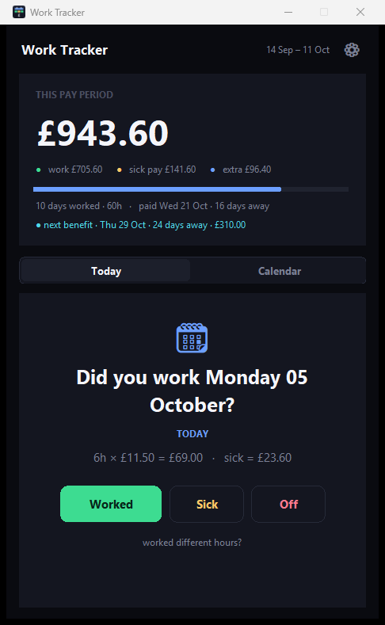
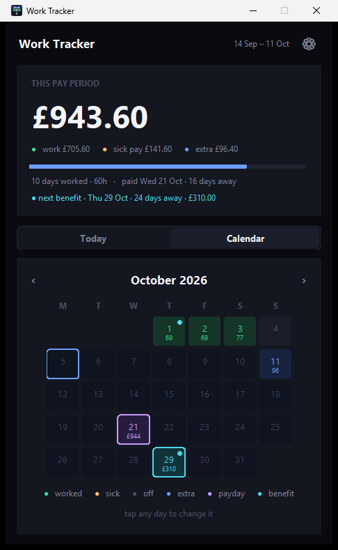

# Work Tracker

[](https://github.com/ekql-ops/work-tracker/actions/workflows/tests.yml)
[](https://www.python.org/downloads/)
[](LICENSE)

A desktop app for people paid by the shift. Answer one question a day —
**worked, sick, or off** — and it tells you what you've earned and when it
lands in your bank.

Built for hourly work where the pay period doesn't line up with the calendar
month, the rate changes at the weekend, and a run of sick days needs tracking
separately because it's paid at a different rate.

<p align="center">
  
  
</p>

> Screenshots use made-up figures.

## Why it exists

Payslips arrive weeks after the work. If your pay period runs 14 September to
11 October but you're paid on 21 October, then on the 5th you have no
straightforward way to know what you're owed — especially if some of those days
were sick days paid at a flat daily rate rather than your hourly one.

This keeps a running total of exactly that, so the payslip holds no surprises.
When one does, you have a day-by-day record to check it against.

## What it does

- **One tap a day.** It names the exact date it's asking about, so catching up
  after a few days away is unambiguous.
- **Never loses a day.** If you skip a few, it scans the last 60 days for
  anything unanswered and walks you through each one in order.
- **Different rates per weekday.** Set an hourly rate for each day
  independently. Leave a day blank and it's not a working day — it'll never be
  asked about.
- **Sick pay tracked separately.** Logged at a flat daily rate, only on days
  you'd normally work, and totalled apart from your wages.
- **Knows your real pay cycle.** Four-week periods anchored to a date from your
  payslip, with the payday offset — because the money usually arrives a week or
  two after the period closes.
- **One-off amounts.** Back pay, a correction, a bonus — recorded on a date
  without pretending it was a worked day.
- **Benefit payments on the calendar.** Any recurring payment (PIP, Universal
  Credit, anything on a fixed cycle) shown alongside your wages so you can see
  what's coming. Deliberately **never** counted as earnings.
- **Month calendar.** Every day colour-coded with its amount. Tap any day to
  change it.

## Install

### Windows — download and run

Grab `WorkTracker-windows.zip` from
[Releases](https://github.com/ekql-ops/work-tracker/releases), unzip it
anywhere, and run `Work Tracker.exe`. No Python needed.

Windows will show a SmartScreen warning the first time because the app isn't
code-signed — click **More info → Run anyway**. (Signing costs a few hundred
pounds a year, which isn't worth it for a free tool.)

To pin it: open the app, right-click its taskbar icon → **Pin to taskbar**.

### From source — any platform

```bash
git clone https://github.com/ekql-ops/work-tracker.git
cd work-tracker
python app.pyw
```

Needs Python 3.10+ and tkinter, both standard. On Debian/Ubuntu tkinter is a
separate package: `sudo apt install python3-tk`.

## First run

The app opens a setup screen. You need four things, three of which are on a
payslip:

| Field | Where to find it |
|---|---|
| **Hourly rate per day** | Your payslip. Leave blank any day you don't work. |
| **Hours per day** | Your usual shift length. |
| **Sick pay per day** | Your SSP daily rate, or 0 if you'd rather not track it. |
| **Period end date** | The **last day of a pay period** on a payslip — not the payday. |
| **Paid N days later** | Days between that period ending and the money arriving. |

That last pair is the bit worth getting right. If a payslip says it covers
*20/07 to 16/08* and was paid on *26/08*, the period end date is `2026-08-16`
and the offset is `10`.

Everything is editable afterwards from the **⚙** button.

## Command line

The same data, scriptable — useful for bulk edits and for checking figures
without opening a window.

```bash
python -m worktracker.cli period          # this period's breakdown and payday
python -m worktracker.cli log             # log today as worked
python -m worktracker.cli sick 2026-09-14 --until 2026-09-21
python -m worktracker.cli adjust 2026-10-11 184.88 --note "back pay"
python -m worktracker.cli forecast --until 2026-10-11 --assume work
python -m worktracker.cli recalc          # re-price history after a pay rise
python -m worktracker.cli where           # path to your data file
```

`work <command> --help` explains any of them. Logging a day that's already
recorded is refused unless you pass `--force`, so you can't quietly
double-enter a shift.

## Where your data lives

A single JSON file, outside the app:

| Platform | Path |
|---|---|
| Windows | `%APPDATA%\WorkTracker\work_data.json` |
| macOS / Linux | `~/WorkTracker/work_data.json` |

Reinstalling, updating or deleting the app never touches it. Back it up by
copying that one file. Set `WORKTRACKER_HOME` to put it somewhere else — a
synced folder, say, or a test directory.

Writes are atomic, so a crash or power cut mid-save can't leave you with a
truncated file.

Nothing is sent anywhere. There's no account, no server, no telemetry.

## Development

```bash
python -m pip install pytest ruff
python -m pytest            # 55 tests
python -m ruff check .      # lint, must be clean
```

Tests run against a temporary directory via `WORKTRACKER_HOME`, so the suite
never touches a real install. CI runs them on Windows and Linux across Python
3.10 and 3.12.

### Building the Windows app

```bash
python -m pip install pyinstaller
python -m PyInstaller --noconfirm --clean --windowed --onedir \
  --name "Work Tracker" --icon assets/icon.ico \
  --add-data "assets/icon.ico;." app.pyw
```

Pushing a `v*` tag builds this in CI and attaches the zip to a release.

### Layout

```
worktracker/core.py   data model, pay periods, totals — no UI
worktracker/gui.py    tkinter app
worktracker/cli.py    command line
tools/make_icon.py    regenerates the icon
```

`core.py` has no UI imports, which is what makes the logic testable without
driving a window.

## A note on sick pay

The app tracks whatever daily rate you give it. It does **not** know your
country's statutory sick pay rules — waiting days, linked periods, qualifying
conditions — and makes no attempt to. Those vary by country, employer and
circumstance, and getting them wrong silently would be worse than not trying.

Put in the rate your employer actually pays and check the first payslip that
includes sick pay. If it differs, `ssp` then `recalc` re-prices your history in
one go.

## Licence

MIT — see [LICENSE](LICENSE).
